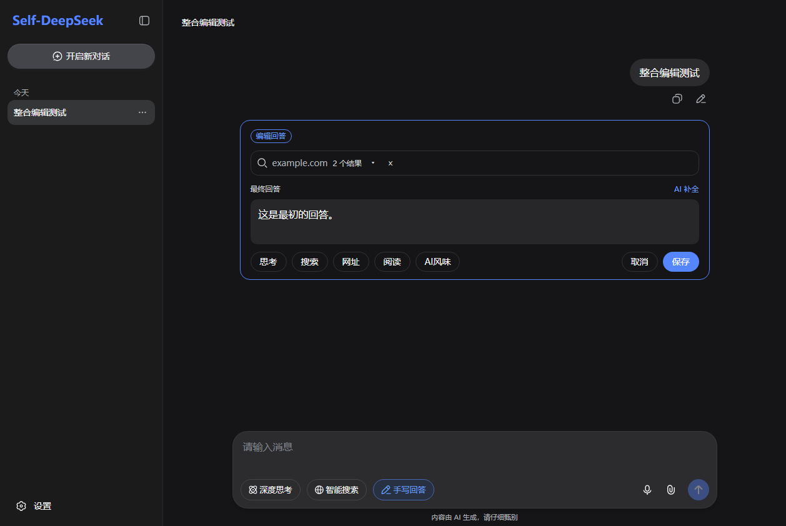

# Deepthink

DeepSeek 网页端的本地复刻，基于官方 [deepseek-ai/chat-demo](https://github.com/deepseek-ai/chat-demo)（MIT），
额外加了一个 **手写回答** 模式：不调用模型，自己敲思考过程和最终回答；需要时可以借 AI 接着补、插入「AI 味」句子，
或者真的联网搜索 / 阅读网页。


## 功能

- **手写回答**：发问题不请求模型，落一张按步骤拼的编辑卡；思考、正文、搜索、阅读可以任意排序，
  保存后和模型回答完全一样（同样的折叠思考、来源卡片、复制/编辑/重新生成）。
- **AI 补全**：按当前草稿续写，前缀会带上前面已经写好的思考，接着整条思路写而不是重新开头；
  空返回会自动重试并退回对话式续写。
- **AI 味句子**：开场 / 承接 / 思考腔 / 收尾四组句子，点一下插到光标处。
- **工具步骤**：
  - 搜索：填关键词真走 `deepseek_web_search`；或「跳过搜索」建一个带关键词的空步骤，稍后在卡片里补网址；
  - 阅读：先插一个「已阅读网页」标签，点 AI 补全时才真的用 `deepseek_read_url` 抓正文；
  - 卡片里可以改名、换链接、增删网页、重新搜索（右上角 ⟳），每条搜索步骤各占一行。
- **编辑回答**：消息底部的铅笔打开同一套步骤编辑器，改完就地更新，不新增版本；取消会用快照恢复。
- 上游原有的能力都在：多会话、自动标题、分支切换、流式输出、深度思考、智能搜索与引用、附件上传、
  语音输入与朗读、Markdown / 代码高亮 / KaTeX / Mermaid、明暗主题、移动端、历史导入导出。




## 快速开始

需要 Node.js 22.12+ 和 pnpm。

```sh
pnpm install
pnpm dev          # http://localhost:8090
```

生成静态产物：

```sh
pnpm build        # 输出到 dist/
node serve.mjs    # 本地静态服务，默认 http://127.0.0.1:8090
```

Windows 下构建完成后可直接双击 `start.cmd`（起服务并打开浏览器）。

首次使用在左下角「设置」里填 DeepSeek API Key（存在浏览器 localStorage）。不想填也能用纯手写模式：
手写、粘网址、保存全都不联网，只有点搜索 / 阅读 / AI 补全时才需要 Key。

`serve.mjs --seed-key <credentials.yaml>` 可以从 YAML 文件里读 `DEEPSEEK_API_KEY` 注入到页面（只改内存里的 HTML，
不落盘、不写进 dist），方便自动化测试；平时直接手填即可。

## 手写模式怎么用

1. 打开输入框工具栏的「手写回答」，正常发问题；
2. 对话里出现步骤编辑卡：直接写最终回答；开了深度思考会先带一段思考；
3. 需要时加「搜索 / 阅读 / 思考」步骤，或用「AI 补全」让它接着写；
4. 草稿每 600ms 自动保存，`Ctrl/⌘ + Enter` 保存、`Esc` 取消；
5. 保存后还能用消息底部的铅笔继续改，包括工具步骤。

## 与上游的关系

界面、请求协议和大部分功能来自 [deepseek-ai/chat-demo](https://github.com/deepseek-ai/chat-demo)，
按其 MIT License 使用（见 [LICENSE](LICENSE)）。本仓库在此基础上加了手写回答相关的功能，并改名为 Deepthink。
非 DeepSeek 官方项目，与深度求索公司无关。

## 目录

```
src/app/              应用布局、主题
src/components/       聊天、手写编辑器、设置等界面
src/services/api/     请求、SSE、协议类型
src/services/chat/    会话、分支、手写步骤、工具步骤、本地存储
serve.mjs             本地静态服务器（含可选的 Key 注入）
scripts/build.mjs     跨平台构建脚本
```

## 注意

- 只监听 `127.0.0.1`，没有自建后端，浏览器直连 `api.deepseek.com`。
- 会话与附件存在浏览器 IndexedDB，API Key 与设置存在 localStorage，按站点源隔离。
- 手写内容里的工具结果（例如手填的网址）只是本地数据，不会上传；搜索、阅读、补全会按次计费。
