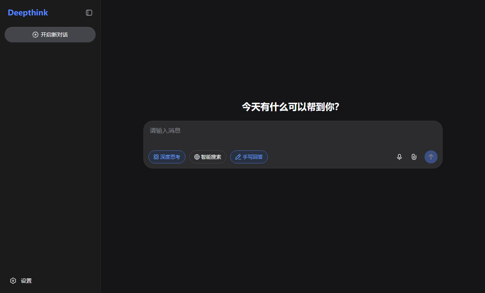
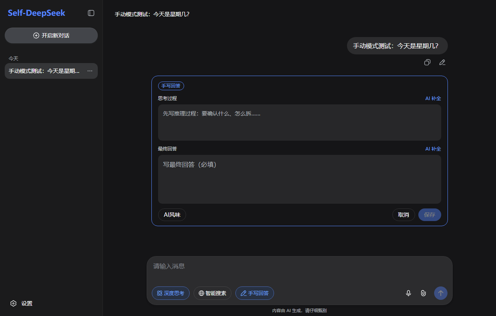
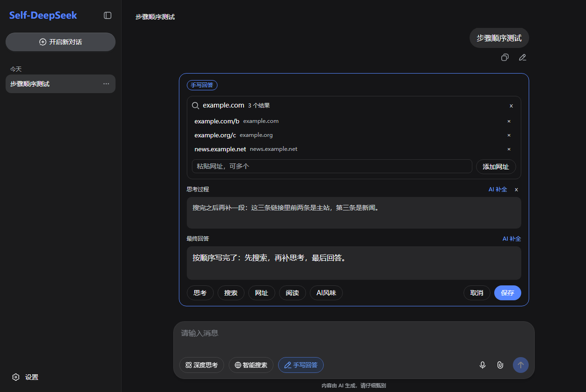

# Deepthink

DeepSeek 网页端的本地复刻，外加一个 **手写回答** 模式：自己敲思考过程和最终回答，需要时让 AI 接着补、插几句
「AI 味」的话，或者真的去联网搜索、阅读网页——像一个「手动档」的 DeepSeek。

**在线体验：<https://gmh13552.github.io/deepthink/>**
（第一次打开在左下角「设置」里填自己的 API Key；不想填也能用纯手写模式。）



## 能做什么

- **手写回答** — 不调用模型，发完问题直接在对话里写思考过程和最终回答；保存后和正常回答一模一样：
  同样的折叠思考、来源卡片、复制 / 编辑 / 重新生成。
- **AI 补全** — 写到一半让 AI 接着写，接着你的思路往下，而不是从头重新说一遍。
- **AI 味句子** — 开场、承接、思考腔、收尾四组现成句子，点一下插到光标处。
- **工具步骤** — 可以真的联网搜索、真的读网页；也可以「跳过搜索」自己填来源。搜索卡片里能改名、换链接、
  增删网页、重新搜索，每一步各占一行。
- **编辑回答** — 消息底部的铅笔用同一套编辑器，思考、正文、工具步骤都能改，就地更新。
- 以及网页版本来的能力：多会话、消息分支、深度思考、附件上传、语音输入与朗读、公式与图表、明暗主题、历史导入导出。

| 手写编辑卡 | 工具步骤 |
| --- | --- |
|  |  |


## 为什么做这个

有时候你比模型更想自己写完这一条回答——但还想要官方的界面、思考折叠、搜索步骤和来源卡片。
于是有了 Deepthink：把 DeepSeek 网页端搬到本地，再给它加一个「人工档」。

## 本地运行

```sh
git clone https://github.com/GMH13552/deepthink.git
cd deepthink
pnpm install
pnpm dev
```

构建静态页用 `pnpm build`（产物在 `dist/`）；Windows 上构建完可以直接双击 `start.cmd` 本地打开。

## 关于 API Key

- 仓库和线上页面**不包含任何 API Key**；Key 只保存在你自己浏览器的 localStorage 里。
- 手写、保存、粘贴网址都不联网；只有点「搜索 / 阅读 / AI 补全」时才会请求 DeepSeek 接口，按你自己的账号计费。

## 致谢

界面、请求协议和大部分功能来自 [deepseek-ai/chat-demo](https://github.com/deepseek-ai/chat-demo)（MIT），
本项目在此基础上加了手写回答相关的功能并改名为 Deepthink，[LICENSE](LICENSE) 保留原版权声明。
非 DeepSeek 官方项目。
